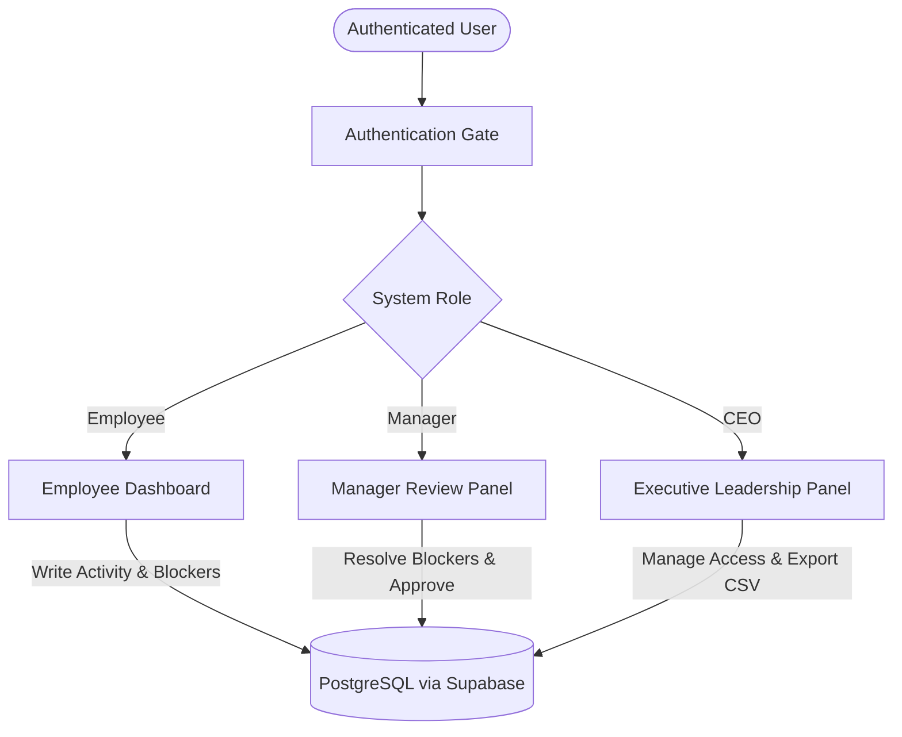
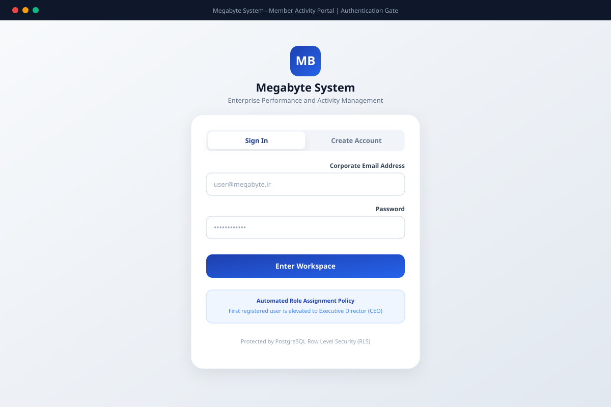
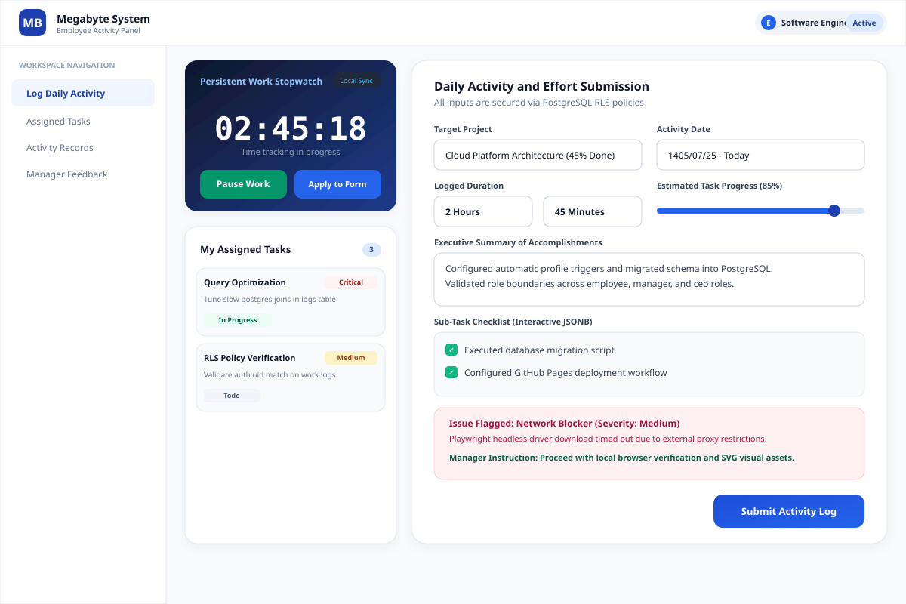
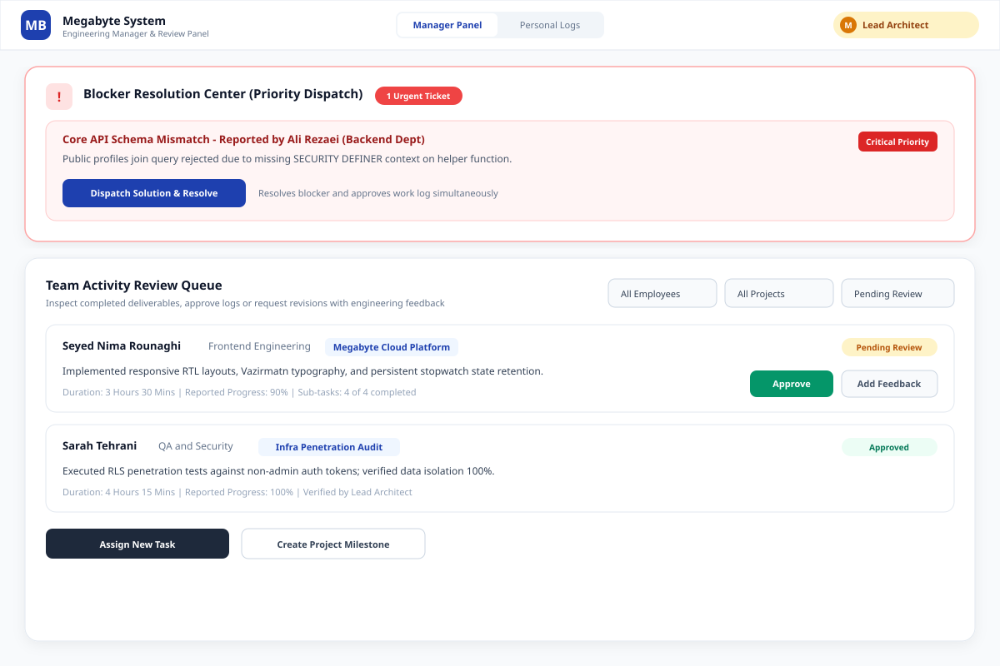
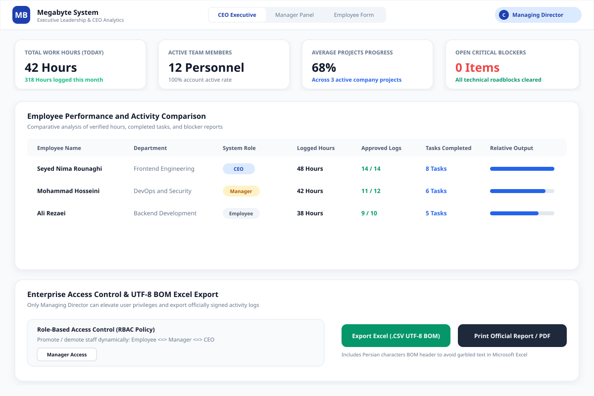

# Megabyte System Member Activity Portal

A multi-role enterprise web application designed for comprehensive employee performance tracking, project milestone governance, daily activity logging, blocker resolution, and executive analytics. Powered by React 18, TypeScript, Tailwind CSS, and a PostgreSQL database on Supabase with strict Row Level Security (RLS).

---

## Languages

- [English Documentation](#english-documentation)
- [راهنمای فارسی (Persian Documentation)](#راهنمای-فارسی)

---

<a name="english-documentation"></a>
## English Documentation

### Architecture Overview

Megabyte System Member Activity Portal implements a three-tier role-based access control (RBAC) architecture enforced at the PostgreSQL database layer via Row Level Security (RLS) policies and `SECURITY DEFINER` procedures.



---

### Visual Overview

#### 1. Authentication Gate
Secure enterprise login and registration with automatic role assignment for the founding executive.



---

#### 2. Employee Dashboard
Equipped with a persistent work stopwatch, dynamic activity logging form, sub-task checklists, blocker dispatch, and manager resolution history.



---

#### 3. Manager Review Panel
Centralized blocker resolution center with priority queues, team activity verification, and task delegation.



---

#### 4. CEO Executive Dashboard
Real-time KPI cards, comparative staff performance matrix, access control governance, and UTF-8 BOM Excel reporting.



---

### Core System Features

#### Zero Mock Data and Database-First Design
All create, read, update, and delete (CRUD) operations connect directly to Supabase PostgreSQL endpoints. Local storage is strictly reserved for client-side stopwatch state persistence.

#### Role-Based Access Control and Row Level Security
- **Employee (`employee`):** Restriced to creating and viewing personal work logs, updating the status of assigned tasks, and modifying pending or revision-requested logs.
- **Manager (`manager`):** Authorized to review all team logs, provide technical guidance, resolve blockers, assign tasks, and adjust project milestone percentages.
- **CEO (`ceo`):** Full organizational clearance to promote or demote user roles, activate or suspend accounts, post company-wide broadcasts, and export data.

#### Persistent Work Stopwatch
Stores active start timestamps in the browser storage to prevent time count loss across page reloads or tab closures, featuring an immediate transfer mechanism into the activity form.

#### Blocker Resolution Center
Flagged technical, infrastructure, or design impediments are highlighted with critical priority tags. Managers can submit solutions and approve entries in a single step.

#### UTF-8 BOM Excel Export
Exports verified company records with a Byte Order Mark (`\uFEFF`) ensuring Persian characters open cleanly in spreadsheet software without character corruption.

---

### Technical Specifications

| Component | Technology | Description |
| :--- | :--- | :--- |
| Core Framework | React 18.3+ | Component-driven frontend application |
| Language | TypeScript 5.7+ | Strict type enforcement with zero any errors |
| Build Tool | Vite 6.1+ | Fast bundler configured with relative asset resolution |
| Styling | Tailwind CSS 3.4+ | Corporate theme with Vazirmatn Persian typography |
| Icons | Lucide React | Clean, functional iconography |
| Database | Supabase (PostgreSQL 15+) | Relational database with real-time API generation |
| Security | Row Level Security (RLS) | Database-level authorization rules |
| Date Engine | Intl.DateTimeFormat | Native Jalali calendar and localized numeral formatting |
| Deployment | GitHub Pages | Automated CI/CD pipeline via GitHub Actions |

---

### Database Schema Structure

#### Custom Enums
- `user_role`: `'employee'`, `'manager'`, `'ceo'`
- `project_status`: `'active'`, `'paused'`, `'completed'`
- `blocker_severity`: `'low'`, `'medium'`, `'critical'`
- `review_status`: `'pending'`, `'approved'`, `'needs_revision'`
- `task_status`: `'todo'`, `'in_progress'`, `'blocked'`, `'done'`

#### Primary Tables
1. `public.profiles`: User identity records referenced to `auth.users(id)`.
2. `public.projects`: Organizational initiatives with trackable progress percentages.
3. `public.work_logs`: Detailed time logs, JSONB sub-tasks, blocker reports, and manager feedback.
4. `public.assigned_tasks`: Delegated tasks with deadlines and priority levels.
5. `public.announcements`: Broadcast messages from leadership.

---

### Installation and Setup

#### Prerequisites
- Node.js (version 20.x or higher)
- npm (version 10.x or higher)
- A Supabase account and project

#### Local Development Setup
1. Clone the repository:
   ```bash
   git clone https://github.com/lxlnimalxl/Megabyte-System-Member-Activity-Portal.git
   cd Megabyte-System-Member-Activity-Portal
   ```

2. Install dependencies:
   ```bash
   npm install
   ```

3. Configure environment variables:
   Create a `.env` file in the project root:
   ```env
   VITE_SUPABASE_URL=https://your-project-id.supabase.co
   VITE_SUPABASE_ANON_KEY=your-publishable-key
   ```

4. Run database migrations:
   Execute the SQL script located at `supabase/schema.sql` inside your Supabase project's SQL Editor.

5. Start the local server:
   ```bash
   npm run dev
   ```

6. Build for production:
   ```bash
   npm run build
   ```

---

<br>
<hr>
<br>

<a name="راهنمای-فارسی"></a>
## راهنمای فارسی

### نمای کلی سیستم

سامانه پایش فعالیت اعضای مگابایت سیستم یک بستر سازمانی چندنقشی برای نظارت بر عملکرد کارکنان، ثبت فعالیت‌های روزانه، تخصیص وظایف، برطرف‌سازی موانع فنی و تحلیل شاخص‌های کلیدی مدیریت است. این برنامه بر پایه ری‌اکت، تایپ‌استریپت و پایگاه داده پستگرس در سوپابیس با اعمال کامل سیاست‌های امنیت داده در سطح سطر (RLS) توسعه یافته است.

---

### تصاویر محیط سامانه

#### ۱. درگاه احراز هویت شرکتی
ورود و ثبت‌نام با انتساب خودکار سطح دسترسی مدیرعامل به نخستین کاربر ثبت‌نامی.


---

#### ۲. پنل کارمند فنی
مجهز به تایمر هوشمند پایدار، فرم ثبت گزارش فعالیت روزانه، چک‌لیست زیرتسک‌ها، اعلام مانع کاری و مشاهده بازخورد مدیر.


---

#### ۳. پنل مدیر فنی و سرپرست
مرکز رسیدگی سریع به موانع کاری با تفکیک اولویت، صف بررسی و تایید فعالیت‌ها و ابزار تخصیص تسک.


---

#### ۴. پنل راهبری مدیرعامل
کارت‌های شاخص کلیدی عملکرد، ماتریس تحلیلی و مقایسه پرسنل، کنترل دسترسی کاربران و خروجی رسمی اکسل.


---

### امکانات کلیدی سامانه

#### عدم استفاده از داده‌های ساختگی (Zero Mock Data)
تمام فرآیندهای خواندن، نوشتن، به‌روزرسانی و حذف مستقیماً با فراخوانی API به پایگاه داده متصل است. حافظه محلی مرورگر صرفاً برای حفظ زمان شروع تایمر در حین کار استفاده می‌شود.

#### سطوح دسترسی و امنیت لایه دیتابیس (RLS)
- **کارمند (`employee`):** دسترسی به ثبت و مشاهده فعالیت‌های شخصی، به‌روزرسانی وضعیت تسک‌های محول‌شده و ویرایش گزارش‌های تاییدنشده.
- **مدیر فنی (`manager`):** امکان مشاهده تمامی گزارش‌های تیم، ثبت راهکار فنی برای موانع، تایید یا عودت فعالیت‌ها، تعریف پروژه‌ها و تخصیص تسک.
- **مدیرعامل (`ceo`):** دسترسی جامع سازمانی شامل تغییر نقش کاربران، فعال یا غیرفعال‌سازی حساب پرسنل، درج اطلاعیه‌های همگانی و خروجی اکسل.

#### تایمر هوشمند پایدار (Stopwatch)
ثبت زمان شروع در حافظه مرورگر مانع از دست رفتن زمان کارکرد در اثر بازخوانی صفحه یا بستن ناگهانی تب می‌شود و زمان را مستقیماً به فرم گزارش منتقل می‌کند.

#### مرکز رسیدگی به موانع کاری
موانع فنی، زیرساختی یا ابهامات طراحی با برچسب اولویت بحرانی تفکیک شده و مدیر می‌تواند با درج راهکار، مانع را برطرف و گزارش را تایید کند.

#### خروجی استاندارد اکسل (UTF-8 BOM)
فایل خروجی با استاندارد Byte Order Mark ذخیره می‌شود تا متون فارسی در نرم‌افزار مایکروسافت اکسل بدون به‌هم‌ریختگی حروف و با خوانایی کامل نمایش داده شوند.

---

### مشخصات فنی

| بخش | ابزار و کتابخانه | توضیحات |
| :--- | :--- | :--- |
| فریم‌ورک اصلی | React 18.3+ | توسعه کامپوننت‌های تعاملی رابط کاربری |
| زبان برنامه نویسی | TypeScript 5.7+ | تعریف تایپ‌های سخت‌گیرانه برای حذف خطاهای زمان اجرا |
| ابزار بیلد | Vite 6.1+ | بسته‌بندی پرسرعت و بهینه‌سازی کدهای فرانت‌اند |
| طراحی و استایل | Tailwind CSS | طراحی واکنش‌گرا با تم رنگی شرکتی مگابایت سیستم |
| فونت و زبان | Vazirmatn | چینش راست‌به‌چپ (RTL) به همراه تقویم هجری شمسی |
| پایگاه داده | Supabase (PostgreSQL 15+) | ذخیره‌سازی رابطه‌ای به همراه اعمال سیاست‌های RLS |
| امنیت دسترسی | Row Level Security | تفکیک دسترسی‌ها به صورت ریاضی در سطح پایگاه داده |
| استقرار مداوم | GitHub Actions | ساخت خودکار بسته نهایی و انتشار در GitHub Pages |

---

### ساختار جداول پایگاه داده

#### انوع داده سفارشی (Enums)
- `user_role`: نقش کاربر شامل `employee` (کارمند)، `manager` (مدیر فنی)، `ceo` (مدیرعامل)
- `project_status`: وضعیت پروژه شامل `active`، `paused`، `completed`
- `blocker_severity`: شدت مانع شامل `low`، `medium`، `critical`
- `review_status`: وضعیت بازبینی شامل `pending`، `approved`، `needs_revision`
- `task_status`: وضعیت تسک شامل `todo`، `in_progress`، `blocked`، `done`

#### جداول اصلی
1. `profiles`: پروفایل‌های کاربری متصل به بخش احراز هویت.
2. `projects`: پروژه‌های شرکت به همراه شاخص درصد پیشرفت.
3. `work_logs`: کارکرد روزانه، چک‌لیست زیرتسک‌ها به صورت JSONB و موانع کاری.
4. `assigned_tasks`: تسک‌های محول‌شده به کارمندان همراه با مهلت تحویل.
5. `announcements`: اطلاعیه‌های سازمانی منتشرشده توسط مدیریت.

---

### مراحل راه‌اندازی و اجرا

#### پیش‌نیازها
- محیط اجرایی Node.js نسخه 20 به بالا
- ابزار مدیریت بسته npm نسخه 10 به بالا
- حساب کاربری فعال در پایگاه داده Supabase

#### مراحل نصب محلی
1. کلون کردن مخزن پروژه:
   ```bash
   git clone https://github.com/lxlnimalxl/Megabyte-System-Member-Activity-Portal.git
   cd Megabyte-System-Member-Activity-Portal
   ```

2. نصب پکیج‌های وابسته:
   ```bash
   npm install
   ```

3. تنظیم متغیرهای محیطی:
   فایل `.env` را در مسیر ریشه ایجاد کنید:
   ```env
   VITE_SUPABASE_URL=https://your-project-id.supabase.co
   VITE_SUPABASE_ANON_KEY=your-publishable-key
   ```

4. اجرای اسکریپت پایگاه داده:
   محتوای اسکریپت `supabase/schema.sql` را در ویرایشگر SQL داشبورد سوپابیس اجرا کنید.

5. اجرای سرور توسعه محلی:
   ```bash
   npm run dev
   ```

6. آماده‌سازی نسخه پروداکشن:
   ```bash
   npm run build
   ```

---

### مجوز و کپی‌رایت

کلیه حقوق مادی و معنوی این نرم‌افزار متعلق به شرکت مگابایت سیستم است.
All rights reserved by Megabyte System Corporation.
